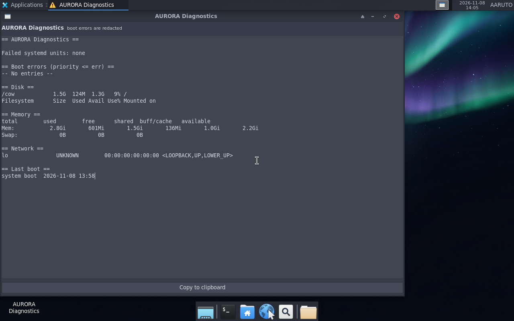

<div align="center">


# AURORA OS

### A bootable Ubuntu 26.04 LTS live desktop with XFCE, branded LightDM login, and AURORA identity

[](https://github.com/AARUTO347/aurora-os/releases/latest)
[](LICENSE)
[]()
[]()

**Made by [AARUTO](https://github.com/AARUTO347) (Abhishek Solanki)**

*Credits: DP-_-, DEV*

[Features](#-features) • [Download](#-download) • [Installation](#-installation) • [Documentation](#-documentation) • [Building](#-building)

**Website:** https://aaruto347.github.io/aurora-os/

</div>

---

## About

AURORA OS is a custom bootable Linux desktop built on **Ubuntu 26.04 LTS** with an aurora-inspired dark visual identity, a branded login screen, and an XFCE session designed to run directly from the ISO — no installation required.

## Current Status

**0.5.0-dev — login, logout, switch-user, polkit and Firefox browser rendering verified** (Milestone 4 in progress)

> **Production release: BLOCKED.** A fail-closed authentication gate
> (`scripts/release-gate.sh`) now refuses to publish any image that carries
> shared live credentials, empty-password authentication, passwordless
> sudo/PolicyKit, test-only root serial autologin, or casper live-session
> injection. It inspects both the squashfs and the initramfs and treats any
> inspection error as FAIL. No production image has been built or boot-tested
> (KI-034 build, KI-035 authentication onboarding). The published `v0.5.0-dev`
> ISO is a **development/test** image only.

Next work is tracked in [docs/ROADMAP.md](docs/ROADMAP.md#immediate-next-actions): browser
rendering under a GPU VM (KI-032), KVM for the test host (KI-003), the release/test profile
split (KI-018), and secure production authentication onboarding (KI-035).

| Milestone | Description | Status |
|:---------:|-------------|:------:|
| 0 | Audit | PASS |
| 1 | Bootable base ISO | PASS |
| 2 | AURORA identity + GUI login | PASS |
| 3 | Functional desktop | In Progress |
| 4 | System utilities | In Progress |
| 5 | Release candidate | Blocked |
| 6 | Optional AI / kernel work | Deferred |
| 7 | Installer / UEFI / USB / persistence | Not Started |
| 8 | AURORA apps + optional AI | In Progress |

## Features

- **Ubuntu 26.04 LTS** base with kernel `7.0.0-42-generic`
- **XFCE 4.20** desktop environment on Xorg
- **LightDM** with custom AURORA greeter
- **Arc-Dark** theme with elementary-xfce icons
- **AURORA branding** throughout — wallpaper, identity files, hostname
- **Live session** — runs entirely from ISO, no installation needed
- **AURORA Browser** (Mozilla Firefox 159.0.1, software WebRender) with a launcher — renders fully without a GPU; Falkon and Epiphany remain installed as fallbacks
- **Session actions** — Log Out, Switch User (LightDM dm-tool) and Lock Screen
- **AURORA apps** — System Info (kernel, CPU, memory, storage, session), Diagnostics (failed units, boot errors, resources), Settings and Applications launchers
- **Fast boot** — offline-only units masked, 30 s systemd job timeouts, apt fast-fail
- **BIOS-only image** — tested in QEMU (UEFI not supported; no installer)

## Download

| Version | Size | SHA256 |
|---------|------|--------|
| [v0.5.0-dev](https://github.com/AARUTO347/aurora-os/releases/tag/v0.5.0-dev) | 1002 MB | `29691f1d321bc4c6806f673004d7836a7e1a407e01a5a267a99fc7b17dc1e756` |

> **Note:** Development/test image, BIOS-only live ISO. UEFI boot not yet supported (KI-015).
> Not a production release; see [SECURITY.md](SECURITY.md) and the test-profile login warning below.

## Installation

### Quick Start (QEMU)

```bash
qemu-system-x86_64 -machine q35 -accel tcg -m 2048 -smp 2 \
  -cdrom aurora-os-0.5.0-dev-amd64.iso -boot d -vga std \
  -display gtk,zoom-to-fit=on -vnc 127.0.0.1:1 \
  -serial file:/tmp/aurora-serial.log -no-reboot
```

### VMware

1. Download the ISO from [Releases](https://github.com/AARUTO347/aurora-os/releases)
2. Create a new VM → Choose **Installer disc image (ISO)**
3. Select **BIOS** firmware (not UEFI)
4. Allocate 4 GB RAM or more
5. Boot and enjoy!

A ready-made VMware bundle is available in [`distribution/vmware`](distribution/vmware).

### Test-Profile Login (development image only)

> **Warning — development/test image, not for production.** The published
> `v0.5.0-dev` ISO is a disposable live-session test build. It uses the public
> account below plus Ubuntu casper live provisioning (empty-password auth,
> passwordless sudo/PolicyKit, initramfs autologin injection). Do not boot it on
> physical hardware or treat it as a production OS. A production image is
> **BLOCKED** and gated by `scripts/release-gate.sh`, which refuses to publish
> any image carrying these credentials or passwordless access (KI-035). See
> [SECURITY.md](SECURITY.md).

| Field | Value |
|-------|-------|
| User | `ubuntu` |
| Display Name | `AARUTO` |
| Password | `aurora` (test profile only) |
| Session | XFCE |

## Building

### Prerequisites

- Ubuntu 26.04 (or compatible host with resolute archive)
- `live-build`, `xorriso`, `squashfs-tools`, `grub-pc-bin`, `grub2-common`, `mtools`, `dosfstools`
- Root access for chroot operations

### Build Commands

```bash
# Test-profile ISO (development; not gated)
sudo AURORA_BUILD_DIR="$HOME/aurora-build" sh scripts/build-iso.sh

# Release-profile ISO (root): stripped of test credentials and gated BEFORE
# publication. Refuses to emit an artifact unless scripts/release-gate.sh passes.
sudo AURORA_BUILD_DIR="$HOME/aurora-build" sh scripts/build-release-iso.sh

# Or use make targets
make check        # Static checks + auth-gate regression (no root required)
make test-gate    # Run the production auth-gate regression tests only
sudo make iso     # Build the test-profile ISO
sudo make release # Build the gated release-profile ISO
make verify       # Inspect ISO without booting
make boot         # QEMU TCG with loopback VNC on 127.0.0.1:5901
```

### Build Output

```
$HOME/aurora-build/artifacts/aurora-os-0.5.0-dev-amd64.iso
$HOME/aurora-build/artifacts/aurora-os-0.5.0-dev-amd64.iso.sha256
```

Full build instructions: [docs/BUILD_AND_RUN.md](docs/BUILD_AND_RUN.md)

## Repository Structure

```
aurora-os/
├── build/live-build/          # live-build configuration
│   ├── config/includes.chroot/  # Files copied into image
│   ├── config/package-lists/    # Package selection
│   └── config/hooks/            # Build-time identity & GUI setup
├── distribution/branding/     # Logo, wordmark, login banner, wallpaper, palette
├── distribution/vmware/       # VMware VMX configuration
├── docs/                      # Architecture, build, testing, known issues
├── scripts/                   # Build, verify, run, gate, and static checks
├── tests/                     # Auth-gate regression fixtures (no root)
└── .github/                   # Workflows, issue forms, PR template
```

## Documentation

| Document | Description |
|----------|-------------|
| [Architecture](docs/ARCHITECTURE.md) | System design and component overview |
| [Build & Run](docs/BUILD_AND_RUN.md) | Complete build instructions |
| [Testing](docs/TESTING.md) | Test procedures and evidence |
| [Known Issues](docs/KNOWN_ISSUES.md) | Current limitations and bugs |
| [Roadmap](docs/ROADMAP.md) | Future development plans |
| [Project Audit](docs/PROJECT_AUDIT.md) | Comprehensive project review |
| [Security](docs/SECURITY.md) | Security considerations and the production auth gate |
| [Credits](docs/CREDITS.md) | Acknowledgments |

## Screenshots

| Login | Desktop |
|:-----:|:-------:|
|  |  |

| After Logout | Switch User |
|:------------:|:-----------:|
|  |  |

| AURORA Browser (Firefox) | AURORA Diagnostics |
|:------------------------:|:-------------------:|
|  |  |

| AURORA Browser (Falkon) |
|:------------------------:|
|  |


## License

Source code and distribution configuration: **MIT** — see [LICENSE](LICENSE) and [NOTICE](NOTICE).

Ubuntu packages retain their upstream licenses.

---

<div align="center">

**AURORA OS** — Made with care by [AARUTO](https://github.com/AARUTO347)

[GitHub](https://github.com/AARUTO347/aurora-os) • [Releases](https://github.com/AARUTO347/aurora-os/releases) • [Issues](https://github.com/AARUTO347/aurora-os/issues)

</div>
